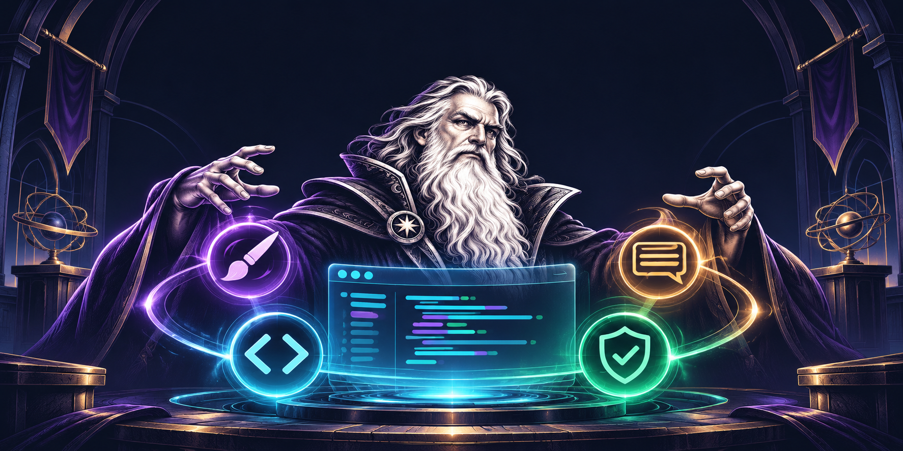
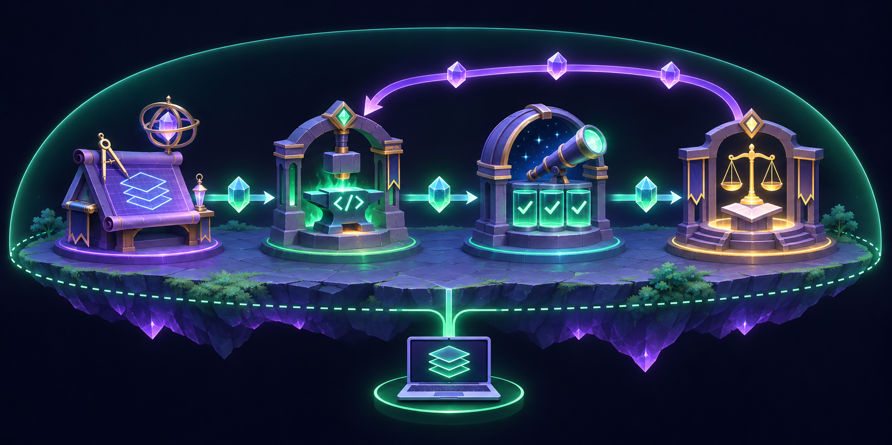

<div align="center">

[简体中文](README.md) · [English](README.en.md)



# Archmage

### Make local agents deliver like a real engineering team

**Connect the agents you already use. Define capabilities, teams, and delivery routes. Keep every change isolated, explicit, and auditable in Git.**

[](LICENSE)
[](Cargo.toml)
[](apps/archmage-desktop)
[](#current-scope)

[Quick Start](#quick-start) · [Why Archmage](#what-problem-does-archmage-solve) · [How It Works](#how-a-run-works) · [Agent Providers](#connect-real-agent-providers) · [Documentation](#documentation-and-troubleshooting)

</div>

---

## What is Archmage?

Archmage is a **local-first multi-agent collaboration runtime**. It does not try to create another model or chat client. It organizes local Agent Providers into a capability-oriented engineering team.

Bind real Codex CLI, DeepSeek Harness, or Qoder ACP instances to distinct capabilities, draw a message flow, and let the Runtime execute, validate, and record their deliveries inside one isolated Git worktree.

```text
One goal → one isolated workspace → explicit roles → structured handoffs → auditable results
```

The current release has four built-in logical capabilities:

| Capability | Primary responsibility | Default workspace access |
| :--- | :--- | :---: |
| **Designer** | Understand the goal, inspect the repository, and design the change | Read-only |
| **Coder** | Implement the design and publish a Changeset | Write |
| **Tester** | Verify behavior, run checks, and report evidence | Write |
| **Reviewer** | Review the implementation and evidence, then complete or return feedback | Read-only |

A Capability is a stable responsibility boundary. The Agent that performs it can be replaced.

## What problem does Archmage solve?

Opening several Agent windows is not collaboration. An engineering task still needs to determine who acts first, what gets handed off, which inputs the next role can trust, where code changes happen, and how interrupted work is recovered.

Archmage puts those decisions in the Runtime instead of leaving them to prompt luck:

- **Real Agents, not simulated personas**: invoke local Providers while preserving their model and session semantics.
- **Explicit team topology**: choose participating Capabilities, an entry, a terminal, and directed delivery edges.
- **Isolated code execution**: give each Run its own Git worktree instead of modifying the source checkout directly.
- **Structured delivery contracts**: require every role to return schema-valid output before routing continues.
- **Trusted Artifacts**: persist results, Changesets, check output, and context snapshots with provenance.
- **Observable, cancellable, recoverable Runs**: drive execution with events and state transitions, not an opaque chat transcript.

## How a Run works

<div align="center">
  
</div>

1. **Freeze the definition**: Archmage snapshots the Team, Capability configuration, and Agent bindings for this Run, so later settings changes cannot silently alter active work.
2. **Create the workspace**: the Runtime provisions an isolated worktree and records a verifiable repository snapshot.
3. **Resolve context**: each Capability receives only the goal, trusted upstream Artifacts, current workspace state, and its configured guidance.
4. **Invoke the Provider**: the Runtime starts Codex, DeepSeek Harness, or Qoder for the bound capability and applies the role's sandbox boundary.
5. **Validate and publish**: only contract-valid output becomes an immutable Artifact; Coder changes are additionally published as a Changeset.
6. **Continue or complete**: the Agent selects a recipient allowed by the Team graph; only the configured terminal Capability may complete the Run.

Feedback loops are explicit. A Team can define `Coder → Reviewer → Coder`, for example, so review feedback creates another independent delivery. The Runtime also enforces a step limit to prevent unbounded loops.

## Connect real Agent Providers

| Provider | Integration | Session behavior inside one Run |
| :--- | :--- | :--- |
| **Codex CLI** | Local CLI invocation with structured output | Each execution is independent |
| **DeepSeek Harness** | Published Python SDK and Runtime binary | Repeated deliveries to one Capability retain a session |
| **Qoder** | Local ACP Provider | Repeated deliveries to one Capability retain a session |

Use **Agent Management** in the desktop app to discover and verify Providers, **Capability Management** to bind Agents and add supplemental prompts or Skill/Tool guidance, and **Team Management** to draw the actual message flow.

> Skill/Tool lists are currently manual guidance for the Agent. They do not enforce permissions or prove that a capability is installed. Built-in role contracts remain fixed, and configuration changes affect new Runs only.

## Quick start

### Install the development CLI

From the repository root:

```bash
cargo install --path crates/archmage-cli --locked --force --root "$HOME/.local"
archmage doctor --offline
archmage run --repo /absolute/path/to/repository --goal "your goal"
```

Inspect Run state and events:

```bash
archmage status <run-id>
archmage logs <run-id>
```

### Start the desktop workbench

```bash
./scripts/dev-desktop.sh
```

The script checks local tooling, installs missing frontend dependencies, and starts both the Vite UI and the Tauri process containing the Rust Runtime. Archmage does not require a separate backend daemon.

For lower-level frontend or Tauri troubleshooting:

```bash
npm install --prefix apps/archmage-desktop
npm run tauri dev --prefix apps/archmage-desktop
```

## Local first, evidence first

Archmage keeps its authority boundary deliberate: models may propose results and routes, while the Runtime owns execution state, Artifact identities, file paths, and state transitions. A downstream Capability reads committed, validated deliveries instead of guessing facts from free-form text.

```text
Agents own reasoning and creation
The Runtime owns identity, boundaries, state, evidence, and delivery
Git exposes the final code truth
```

## Current scope

Archmage is a development preview focused on collaborative delivery in local code repositories:

- Built-in Capabilities are currently fixed to Designer, Coder, Tester, and Reviewer.
- A new message-flow Team contains at least two Capabilities with an explicit entry and terminal.
- Codex, DeepSeek Harness, and Qoder have different session capabilities; the Runtime preserves those differences.
- Archmage is not a long-term memory platform, and manual Skill/Tool guidance is not an executable permission system.
- Treat the current CLI reference and runbooks as the source of truth for commands and behavior.

## Documentation and troubleshooting

- [English documentation index](docs/en/README.md)
- [CLI command reference](docs/en/cli-reference.md)
- [Desktop client guide](docs/en/runbooks/desktop-s0.md)
- [Qoder ACP Provider runbook](docs/en/runbooks/qoder-provider.md)
- [Current-version guide and architecture notes](docs/en/guide.md)
- [Original product brief](target.md)

---

<div align="center">

**One workspace. One visible delivery chain. One team of Agents that actually collaborates.**

</div>
